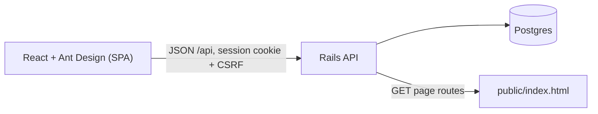

# Architecture

One Rails 8.1 app (API only) with Postgres serves a React (Vite) single-page app built into `public/`. One Docker image, deployed on Render.

## Layers
- `app/controllers/api`: thin JSON controllers; login required everywhere except `POST /api/session`.
- `app/models`: validations backed by DB constraints (NOT NULL, foreign keys, unique and check constraints). Salary revisions, audit events and locked payroll entries are read-only.
- `app/services`: `Employees::Create`, `Employees::CsvExport`, `Employees::SampleData` (seed), `Payroll::EntryCalculator`, `Payroll::Generator`, `Payroll::Exporter`.
- `app/queries`: `EmployeeSearch`, `SalaryStatsQuery`, `SalaryTrendsQuery` — aggregates in SQL, `numeric` only.

## Data model
`countries` (currency, tax rate) · `exchange_rates` (per currency) · `employees` → `salary_revisions` (immutable, own currency) · `payroll_runs` (one per month) → `payroll_entries` (stored inputs and amounts) · `audit_events` (masked field changes) · `users`/`sessions`.

## Key decisions
- Money is `decimal(12,2)` / `BigDecimal`; rounding half up; no floats (the median uses `percentile_disc`, not `percentile_cont`).
- Current salary via one `LEFT JOIN LATERAL`, using the app's date (not the DB clock).
- Payroll entries store what they were calculated from; viewing and exporting never recalculate.
- Only the latest payroll month is open; termination can't fall in a locked month.
- Bank numbers are masked everywhere except the payroll Excel export (and masked in the audit).
- Filters, search and pages live in the URL; the UI does no business maths.
